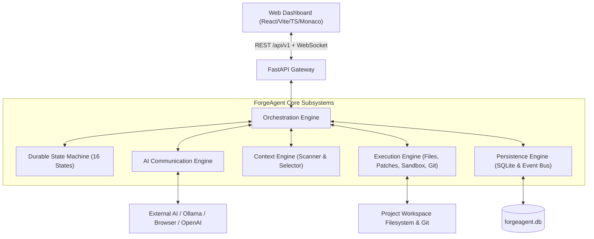

# ForgeAgent V1 Architecture Specification

## 1. System Overview

ForgeAgent V1 is an intelligent orchestration and supervised execution system designed for autonomous software development. Rather than embedding or fine-tuning local model weights directly, ForgeAgent acts as the host controller, security perimeter, and execution runtime around interchangeable external AI providers.

---

## 2. The Five Core Engines

### 2.1 Orchestration Engine
- Coordinates task progression from user submission through scanning, planning, execution, verification, and repair.
- Enforces strict transition legality through the centralized `StateMachine`.
- Manages bounded repair loops (default maximum 4 attempts) with error signature tracking to prevent infinite autonomous loops.
- Reconciles interrupted tasks on restart before executing any file operations.

### 2.2 AI Communication Engine
- Unified connector interface (`AIConnectorBase`):
  - `initialize()`
  - `send_request()`
  - `check_availability()`
  - `get_capabilities()`
  - `cancel()`
- Supported Adapters:
  1. `MockAIAdapter`: Deterministic scriptable provider powering reproducible offline development and acceptance testing.
  2. `OpenAIAdapter`: Compatible with OpenAI, vLLM, LMStudio, and local OpenAI-compatible HTTP endpoints.
  3. `OllamaAdapter`: Connects directly to local Ollama servers, queries `/api/tags`, and runs local inference.
  4. `BrowserHandoffAdapter`: Human-assisted copy/paste workflow with clipboard preparation and validation.
  5. `BrowserAutomationAdapter`: Managed Playwright Chromium persistent profile for confirmed permitted chatbot automation.
- Wire Protocol: `forgeagent.v1` with Pydantic v2 validation.

### 2.3 Context Engine
- Scans project directories and discovers languages, frameworks, entry points, and test scripts.
- Honors `.gitignore` and default security exclusions (`.git`, `node_modules`, `venv`, `dist`, `.env`).
- Explainable relevance selection: filename matching, directory proximity, error trace inspection.
- Enforces per-file limits (max 400 lines) and total budget limits (50,000 characters).
- Sensitive secret redaction (tokens, private keys, authorization cookies).

### 2.4 Execution Engine
- Safe File Manager: Canonical path resolution, strict workspace boundary enforcement, directory traversal blocker, symlink escape checks.
- Patch Applicator: Unified diff and replacement parser with sha256 stale hash verification.
- Sandboxed Command Runner: Windows native allowlisted command execution (`git`, `python`, `node`, `npm`, `pytest`, `uv`) with timeouts (default 60s) and shell operator injection defenses.
- Git Checkpoint System: Transactional commit creation before and after changes, diff inspection, and clean rollback without touching unrelated files.

### 2.5 Persistence Engine
- SQLite relational database with asynchronous SQLAlchemy 2.0.
- Relational entities: `Project`, `ProjectSession`, `Task`, `TaskStep`, `AIConnectorConfig`, `AIRequestRecord`, `ProposedChangeRecord`, `ExecutionRecord`, `TestResultRecord`, `ApprovalRequestRecord`, `CheckpointRecord`, `ActivityEventRecord`, `AppSetting`.
- Internal Event Bus: publishes structured events transactionally and broadcasts via WebSockets with sequence-based replay for reconnection recovery.

---

## 3. Durable State Machine Transitions

| State | Allowed Next States | Purpose |
|-------|---------------------|---------|
| `CREATED` | `SCANNING`, `PAUSED`, `CANCELLED` | Task created in database |
| `SCANNING` | `PLANNING`, `FAILED`, `CANCELLED` | Scanning workspace structure & manifest |
| `PLANNING` | `WAITING_FOR_AI`, `FAILED`, `CANCELLED` | Requesting step plan from AI |
| `WAITING_FOR_AI` | `PARSING`, `VALIDATING`, `APPLYING`, `TESTING`, `FAILED`, `PAUSED`, `CANCELLED` | Waiting for AI provider response |
| `PARSING` | `VALIDATING`, `WAITING_FOR_AI`, `FAILED`, `CANCELLED` | Validating JSON envelope against `forgeagent.v1` |
| `VALIDATING` | `APPLYING`, `WAITING_FOR_APPROVAL`, `WAITING_FOR_AI`, `VERIFYING`, `FAILED`, `CANCELLED` | Pre-flight validation, hash check, permission audit |
| `WAITING_FOR_APPROVAL` | `APPLYING`, `PLANNING`, `PAUSED`, `FAILED`, `CANCELLED` | Paused awaiting explicit user approval |
| `APPLYING` | `TESTING`, `VERIFYING`, `FAILED`, `CANCELLED` | Applying patches & writing files atomically |
| `TESTING` | `VERIFYING`, `REPAIRING`, `COMPLETED`, `FAILED`, `CANCELLED` | Executing automated test suite |
| `REPAIRING` | `WAITING_FOR_AI`, `VALIDATING`, `APPLYING`, `TESTING`, `FAILED`, `CANCELLED` | Capturing failure diagnostics and querying AI repair patch |
| `VERIFYING` | `COMPLETED`, `REPAIRING`, `FAILED`, `CANCELLED` | Finalizing git checkpoints and task summary |
| `COMPLETED` | _Terminal_ | Verification successful |
| `PAUSED` | `SCANNING`, `PLANNING`, `WAITING_FOR_AI`, `APPLYING`, `TESTING`, `CANCELLED` | Paused by user or recovery scan |
| `FAILED` | `RECOVERY_REQUIRED`, `PLANNING`, `CANCELLED` | Execution halted on unrecoverable failure |
| `CANCELLED` | _Terminal_ | Cancelled by user |
| `RECOVERY_REQUIRED` | `CREATED`, `SCANNING`, `PAUSED`, `FAILED`, `CANCELLED` | Ambiguous state requiring user review |

